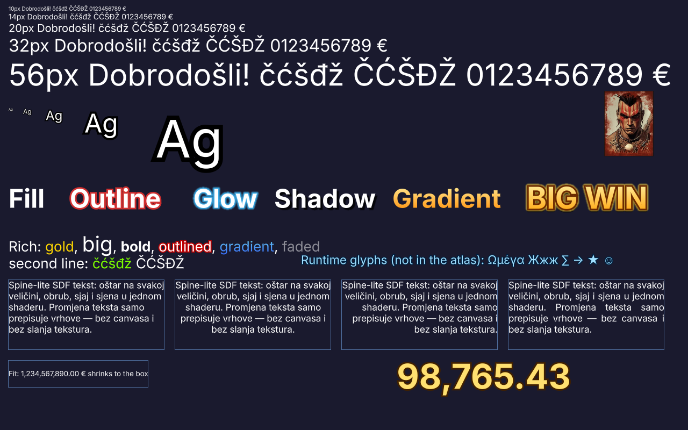
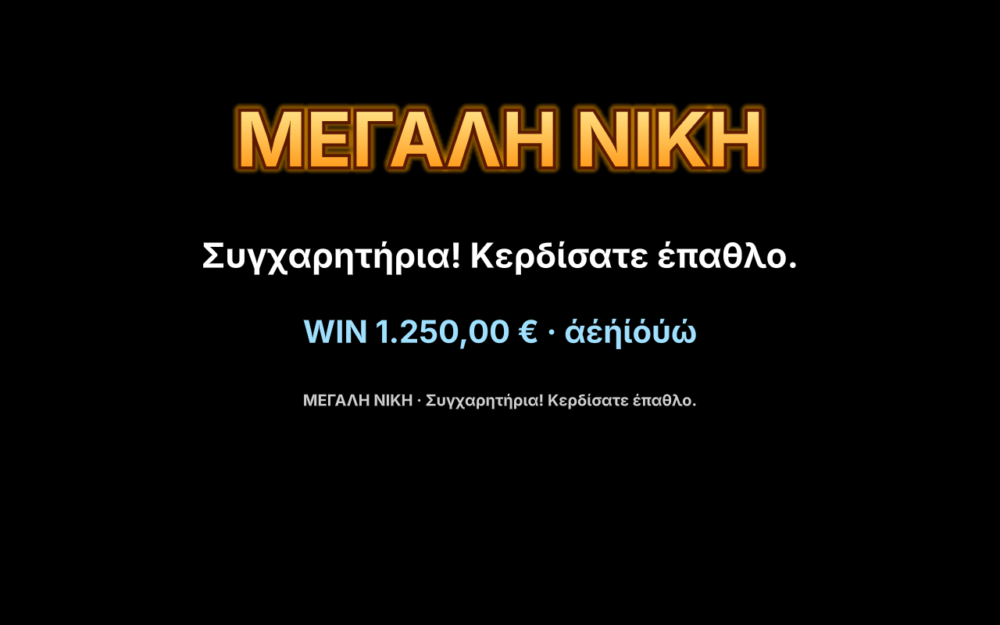
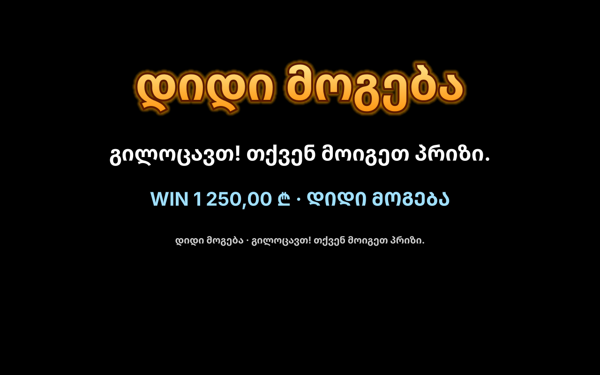

# SDF text

`SdfText` draws text from a **signed distance field** font atlas built at
compile time by `tabula font`. It is the third option next to Pixi's
`Text` (canvas, one texture per label) and `BitmapText` (fixed-size
bitmap glyphs), made for slot UIs with many labels and numbers that change
every frame.



Example code: [`docs/examples/text.ts`](../examples/text.ts) (typechecked).

## Why not Pixi Text or BitmapText

| | Pixi `Text` | Pixi `BitmapText` | `SdfText` |
|---|---|---|---|
| Change the text | redraws a canvas and **uploads a texture** | rebuilds glyph sprites | rewrites vertices only |
| Scale up / zoom | blurry (or re-render at a new resolution) | blurry | sharp at any scale (1-2 px AA edge from 0.25× to 8×) |
| Outline / glow / shadow / gradient | yes (canvas, slow) | baked into the bitmap font | per label at runtime, same shader |
| Draw calls | one per label | one per font per label | **shared** with neighbouring texts and Spine views |
| Croatian, Greek, Cyrillic, Georgian, Armenian, Vietnamese | yes | only baked glyphs | per-language atlases (`--lang`, `--per-lang`), fallback chains, runtime glyphs for the rest |
| Complex scripts (Arabic, Indic), ligatures | yes (browser shaping) | no | **no** (kerning only) |

Measured with `scripts/text-bench.mjs` (Chromium, Apple M4, Metal; `cpu4x`
= 4× CPU throttle), see [bench-results/reference/2026-10-08-mac-m4-text](../../bench-results/reference/2026-10-08-mac-m4-text/README.md):

| Scenario | Metric | Pixi Text | BitmapText | SdfText |
|---|---|---|---|---|
| 500 static labels | draw calls | 32 | 2 | **1** |
| | render ms / frame | 0.80 | 1.41 | 1.22 |
| 200 labels changing every frame | render ms / frame | 16.1 (cpu4x: 63, 15 fps) | 1.95 | **0.82** |
| | texture uploads / s | 12 000 | 0 | **0** |
| | update ms (numeric path, `setNumber`) | | | **0.05** |
| 1 rolling counter | render ms / frame | 1.65 (60 uploads/s) | 0.31 | **0.24** |
| Mixed (Spine views + 60 labels) | draw calls | 43 | 36 | **7** |

Static labels cost slightly more CPU than a cached `Text` sprite (every
glyph is a quad that is transformed each frame, versus one quad per label),
but use one draw call. Anything that changes is where SDF wins by an order
of magnitude.

## 1. Build fonts

```sh
npx tabula font Inter-Regular.ttf Inter-Bold.ttf -o public/fonts
# public/fonts/Inter-Regular.font.json + Inter-Regular.png (+ .ktx2 with --ktx2 uastc)
npx tabula font Brand.otf --chars "ΑΒΓΩαβγω★" -o public/fonts
```

The compiler runs msdfgen (WebAssembly, no native install) per glyph and
writes multi-channel SDF pages with a true SDF in alpha, the font metrics
and the kerning (GPOS `kern` feature or the legacy `kern` table, checked
against HarfBuzz). See [CLI reference: font](../../../tabula-tools/docs/cli.md#font) for every flag.
The default charset `latin-ext` covers ASCII, Latin-1 and Latin Extended-A
(čćđšž, ĆČĐŠŽ, €, typographic quotes and dashes). Defaults: 48 px per em,
distance range 16 px, so outlines and glows reach up to 1/6 em.

Fonts must be licensed for embedding (OFL fonts such as Inter are fine).

## 2. Load

```ts
const font = await loadSdfFont('/fonts/Inter-Regular.font.json');
// KTX2 pages (UASTC, linear) when built with --ktx2 uastc:
const font2 = await loadSdfFont('/fonts/Inter-Bold.font.json', { renderer: app.renderer, transcoder: '/basis/' });
```

Or through the [asset manifest](manifest.md): `tabula manifest` lists
every `*.font.json` with its pages, load groups can include fonts by name
(`--load-groups` globs match font names too), and
`manager.getFont('Inter-Bold')` returns the loaded font. Fonts are
reference-counted like skeletons and freed by `unloadGroup`.

Free a font loaded directly with `unloadSdfFont(font)` after destroying its texts.

## 3. Draw

```ts
const label = new SdfText('Dobrodošli!', { font, fontSize: 40, fill: 0xffffff });
app.stage.addChild(label);
label.text = 'Sretno!';              // relayout + vertex rewrite, no texture work
label.setStyle({ fill: 0xff0000 });  // any style change: relayout + vertex rewrite
```

`runtime.createText(text, options)` creates the same object and also ticks
its number roll with the runtime. `SdfText` is a Pixi `Container`:
position, scale, rotation, `alpha`, `tint`, `visible`, masks and filters
work as usual. `textWidth`, `textHeight` and `getTextBounds()` give the
laid-out size (for layout and hit areas) without rebuilding the mesh.

On Pixi v8 (`tabula-pixi/pixi-v8`) `SdfText` is a `ViewContainer`: `tint`
is the Container tint, inherited from tinted parents like any Pixi 8 object,
and a text cannot have children ([pixi-v8.md](pixi-v8.md#differences-from-v7)).
Fonts, styles, effects, rolls, languages and batching are the same.

### Style

| Field | Default | Meaning |
|---|---|---|
| `font` | required | an `SdfFont` from `loadSdfFont` / `manager.getFont` |
| `fontSize` | 32 | pixels per em |
| `fill` | 0xffffff | fill color |
| `fillGradient` | null | `[top, bottom]` vertical gradient over each line box |
| `alpha` | 1 | text alpha (multiplied with the container's) |
| `letterSpacing` | 0 | extra pixels between characters |
| `lineHeight` / `lineSpacing` | font's / 1 | line height in pixels (0 = font's), multiplier |
| `kerning` | true | apply the font's kerning |
| `align` | 'left' | 'left', 'center', 'right', 'justify' |
| `verticalAlign` | 'top' | inside `maxHeight`: 'top', 'middle', 'bottom' |
| `wordWrap`, `maxWidth` | false, 0 | wrap at spaces, hyphens and slashes; over-long words break between characters |
| `maxHeight` | 0 | box height for vertical align and fit |
| `fit`, `minFontSize` | 'none', 0 | `'shrink'`: scale the font down until the text fits the box |
| `anchorX`, `anchorY` | 0, 0 | origin inside the box (0.5 = centered) |
| `outline` | null | `{ width, color, alpha? }`, width in px at `fontSize` |
| `glow` | null | `{ radius, color, alpha? }`, soft halo outside the outline |
| `shadow` | null | `{ offsetX, offsetY, blur?, color, alpha? }` |
| `richText` | false | parse tags (below) |
| `fonts` | {} | named fonts for `<font=name>`; `bold` enables `<b>` |
| `fallbackFonts` | [] | fonts searched for characters the main font lacks (before the font's own `fallbacks`) |

Outline width plus glow radius can reach at most half the distance range
(at the defaults 1/6 of `fontSize`); larger values are clamped. Build the
font with a larger `--range` for heavier effects.

### Rich text

With `richText: true`:

| Tag | Example |
|---|---|
| `<color=…>` | `<color=gold>`, `<color=#ffcc00>`, `<color=#ffcc0080>` |
| `<gradient=top,bottom>` | `<gradient=#fff,#3080ff>` |
| `<size=…>` | `<size=48>`, `<size=150%>` |
| `<outline=color[,width]>` | `<outline=#c00000,2>`, `<outline=none>` |
| `<alpha=…>` | `<alpha=0.5>` |
| `<font=name>`, `<b>` | names from the `fonts` style field (`<b>` = `fonts.bold`) |
| `<br>` | line break (as does `\n`) |

Tags nest and close with `</color>` etc. (closing an outer tag closes the
inner ones too). Unknown or malformed tags, and a `<` that does not start
a tag, are printed as text.

### Numbers and counters

```ts
label.setNumber(1234.5, NumberFormats.currency('€', { after: true })); // 1,234.50 €
label.rollTo(98765.43, { duration: 2, format: NumberFormats.money });  // animated
```

`setNumber` writes digits straight into the glyph buffer (no string is
built) and skips the work when the formatted value did not change: 200
counters updating every frame cost about 0.05 ms of update time. `NumberFormats` has `integer`, `money`,
`currency(symbol)`, `european(decimals)`; or pass your own
`{ decimals, thousands, decimal, prefix, suffix, plusSign }`.

### Text in a Spine slot

A win amount on an animated plate, a multiplier on a symbol: give the
Spine project a placeholder slot (a slot with no attachment, on the bone
the text should follow) and put the text in it:

```ts
const amount = runtime.createText('', { font, fontSize: 48, anchorX: 0.5, anchorY: 0.5 });
const plate = runtime.createView(plateAsset).setSlotText('winAmount', amount).play('show');
amount.rollTo(1250, { duration: 1.5, format: NumberFormats.money });
```

The view draws the text itself, at the slot's place in the draw order: in
front of the slots before it, behind the ones after it, in the same batch
as the skeleton. It follows the slot's bone (position, rotation, scale),
takes the slot's color and alpha (fades and color keys in the animation
apply, without rebuilding the text), and hides with the bone. Inside a
clipping attachment's range only glyphs whose center is inside the clip
are drawn (glyphs are not cut). The text's own `x`, `y`, `rotation`,
`scale`, `tint` and `alpha` apply on top, in bone space: `amount.y = -6`
nudges it up by 6 pixels relative to the bone.

- Don't add the text to the stage: the view draws it. Create it with
  `runtime.createText` so number rolls keep updating; the view does not
  destroy it.
- A sleeping view keeps drawing its slot texts live: a number can change
  while the symbol sleeps.
- `view.setSlotText(slot, null)` removes it; releasing a view to its pool
  removes all of them.
- Cost: about 0.1 µs per text per frame over drawing the same text on its
  own (0.2 µs on a sleeping view), no extra draw calls while the font page
  fits the batch's texture units.
- View bounds (`getBounds`, `getPoseBounds`) cover the skeleton only, not
  its slot texts.
- The text sits on the slot's bone origin (`anchor: 'bone'`, the default).
  Placement on point attachments or inside region boxes may come later
  as further `anchor` values.

### Characters not in the atlas

```ts
enableRuntimeGlyphs(font); // draw missing characters with the browser's font, convert to SDF
```

Missing characters (player names, chat, a language you did not bake) are
drawn once with `canvas.fillText`, converted to a distance field (EDT) and
packed into an extra page. They look the same at normal sizes but come from
the browser's font, not the compiled one. Without it, missing characters
fall back to `fallbackFonts`, then to the font's U+FFFD (or `?`) glyph.

## Multiple languages




The two screenshots show Greek from Inter, and Georgian from the Noto Sans
Georgian fallback next to Latin and digits from Inter. Each is one draw
call (`scripts/text-visual.mjs`).

### Characters per language

```sh
npx tabula font Inter-Bold.ttf --lang hr,el,ru -o public/fonts                  # letters of these languages
npx tabula font Inter-Bold.ttf --charset-from locales/*.json -o public/fonts    # exactly what the strings use
```

`--lang` takes each language's CLDR exemplar letters in both cases, plus
ASCII, typographic punctuation, the common currencies and the language's
own currency. Covered: Latin with Latin Extended (hr, sl, cs, pl, hu, ro,
de, fr, es, pt, the Nordic and Baltic languages, …), Greek, Cyrillic (ru,
uk, be, bg, sr, mk, kk), Georgian (with Mtavruli capitals, which
`toUpperCase()` produces), Armenian, Turkish and Vietnamese. Script-wide
sets (`--charset greek,cyrillic,georgian,armenian,vietnamese,currency`)
exist too. See [CLI: font](../../../tabula-tools/docs/cli.md#font).

Fonts can come from Google Fonts at build time (`--google "Noto Sans"
--weights 400,700`). The download is pinned in a lockfile, cached, and the
license is copied next to the output. The runtime never loads web fonts.

### Fallback chains

A primary font often lacks a script, for example Inter has no Georgian.
`--chain` compiles several fonts as one chain: each character goes to the
first font that has it, and the head font's `.font.json` lists the others
under `fallbacks`:

```sh
npx tabula font Inter-Bold.ttf --google "Noto Sans Georgian,Noto Sans Armenian" --weights 700 \
  --chain --lang hr,ka,hy -o public/fonts --name main
```

```ts
const font = await loadSdfFont('/fonts/main.font.json'); // also loads its fallbacks into font.fallbacks
new SdfText('WIN 1 250 ₾ · დიდი მოგება', { font, fontSize: 48 });
```

Per character, the layout searches:

1. the run's font;
2. the style's `fallbackFonts`;
3. the font's `fallbacks`, in order;
4. the runtime glyph generator (`enableRuntimeGlyphs`), if enabled;
5. U+FFFD or `?`.

Fallback glyphs stay consistent with the primary font:

- They sit on the primary font's **baseline**, inside its line box
  (ascender, descender and line height come from the primary font, so
  switching language does not move text).
- They are sized in em (so normalized by unitsPerEm) and matched by **cap
  height** when both fonts state it (`fallbackScale`, clamped to 0.8–1.25;
  Inter to Noto is about 1.02).
- Kerning applies within one font.

Fallback pages share the batch with the primary font's pages. A label in
Georgian and Latin is one draw call while the pages fit the texture units.
`font.fallbacks` is a plain array: assign it to build a chain by hand.

### Per-language atlases

`--per-lang` writes one variant per language (`main@hr`, `main@ka` plus
`NotoSansGeorgian-Bold@ka`, …). The asset manager loads only the current
language's atlases and swaps them on `setLanguage`:

```ts
const manager = await TabulaAssetManager.load('/assets.manifest.json', { renderer: app.renderer, language: 'hr' });
await manager.loadGroup('base');                 // main@hr
const title = runtime.createText('VELIKI DOBITAK', { font: manager.getFont('main'), fontSize: 96 });
await manager.setLanguage('ka');                 // loads main@ka + its Georgian fallback, switches title, frees main@hr
title.text = 'დიდი მოგება';
```

#### Automatic refresh

`setLanguage` updates existing texts by itself. Every `SdfText` registers
the fonts its style uses (`font`, and `fonts` for rich text) in a font
registry. When the new language's fonts have loaded, the manager:

1. switches every live text that uses another variant of a group font
   (`main@hr` → `main@ka`, in `style.font` or `style.fonts`) to the new
   variant. Only those texts re-lay out; texts with other fonts are not
   touched;
2. then releases the old variants. A font is unloaded only when no group
   holds it **and** no live text uses it, so no frame draws with destroyed
   page textures.

`text.followLanguage = false` keeps a text on its font (for example a
language picker label written in each language). Its font stays loaded,
with 0 references in `manager.loadedFonts()`, until the text is destroyed
or switched; loading that language again reuses it without a fetch.
Overlapping `setLanguage` calls end on the last language.

The registry is public: `textsUsingFont(font)` lists the live texts using a
font, and `whenFontUnused(font, callback)` runs `callback` once none does
(use it before `unloadSdfFont` for fonts you load yourself). Change a
text's font through `text.setStyle` (or `replaceFont`), not
`text.block.setStyle`, so the registry sees it.

The atlas sizes per language are in [manifest.md](manifest.md#languages).
With the test build they range from 289 KB (hr) to 477 KB (ka, two pages)
of PNG.

### Not supported

Right-to-left text and complex shaping are not supported: Arabic, Hebrew,
Indic scripts (Devanagari, Bengali, Tamil, …), Thai, Khmer, Myanmar. The
layout places one glyph per code point, left to right, with pair kerning.
It has no bidi reordering, contextual forms, reordering of vowel signs,
ligatures or mark positioning. Text must be precomposed (NFC):
`--charset-from` normalizes the strings, and runtime strings should be
passed through `text.normalize('NFC')`. For these languages use Pixi `Text`,
which uses browser shaping. It can be mixed freely with `SdfText`.

## Batching and performance

- Text quads go through the same `TabulaRenderer` batch as Spine views:
  texts and skeletons drawn consecutively share draw calls while texture
  units last. Text pages use one texture unit per font page.
- Each glyph is one quad per layer (shadow, glow, outline, fill), so a
  label with outline + glow draws three quads per glyph in the same batch.
- Layout and mesh buffers are reused; changing text or numbers allocates
  nothing in the steady state.
- `fwidth`-based anti-aliasing: WebGL2 uses GLSL ES 3.00, WebGL1 needs
  `OES_standard_derivatives` (universal on supported devices).

## Headless use (core)

`SdfTextBlock` from `tabula-pixi` does text, style,
layout and mesh without Pixi: measure text on a server or a worker, or
feed `mesh.positions` / `mesh.words` to another renderer.

## Migrating from Pixi Text / BitmapText

| Pixi | Tabula |
|---|---|
| `new Text('Hi', { fontFamily: 'Inter', fontSize: 40, fill: '#fff' })` | `new SdfText('Hi', { font, fontSize: 40, fill: 0xffffff })` |
| `style.stroke`, `style.strokeThickness` | `outline: { color, width }` |
| `style.dropShadow*` | `shadow: { offsetX, offsetY, blur, color, alpha }` |
| `style.fill: ['#fff', '#f90']` | `fillGradient: [0xffffff, 0xff9900]` |
| `style.wordWrap`, `wordWrapWidth` | `wordWrap: true, maxWidth` |
| `style.align` | `align` (also `'justify'`) |
| `text.anchor.set(0.5)` | `anchorX: 0.5, anchorY: 0.5` |
| `text.updateText()`, `text.width` | `label.textWidth` (layout is lazy, reading it lays out) |
| `BitmapFont.from(...)` / `.fnt` files | `tabula font` → `.font.json` |
| `text.text = String(n)` every frame | `label.setNumber(n, format)` or `rollTo` |
| `BitmapText` added to a pixi-spine slot container | `view.setSlotText('slot', label)` (see [Text in a Spine slot](#text-in-a-spine-slot)) |
| `text.resolution = 2` for crispness | not needed |

Not supported: right-to-left text and complex shaping (Arabic, Hebrew,
Indic scripts, Thai), ligatures, per-character transforms, color emoji. Keep Pixi `Text` for
those (they can be mixed freely with `SdfText`).
