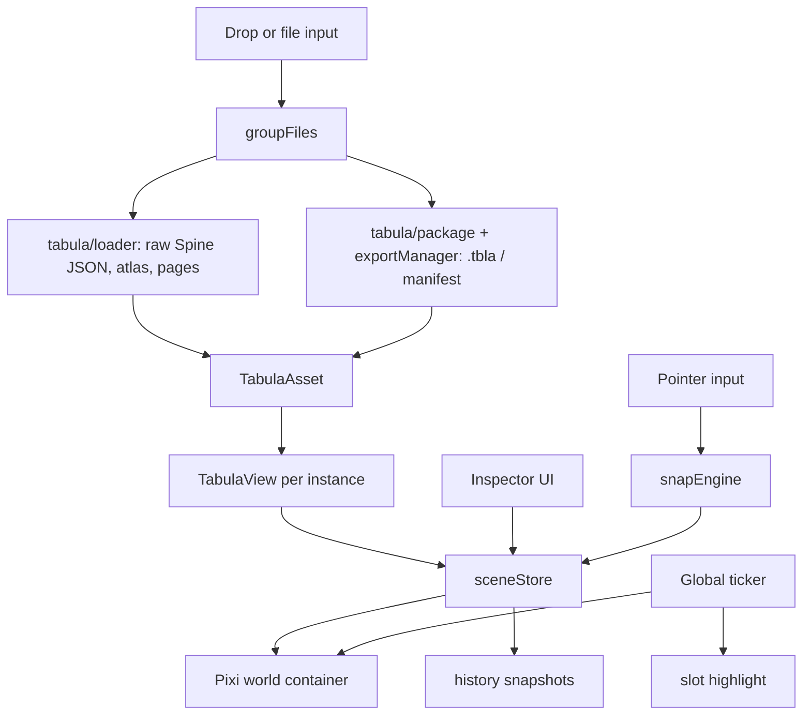

# Architecture

## Module map

```text
src/main.js                 boot, wires store, pixi, and UI
src/constants.js            zoom limits, track colors, mask colors
src/app/sceneStore.js       scene state, selection, listeners
src/app/stage.js            Pixi Application (registers the tabula renderer), camera, world, overlays
src/app/session.js          ticker, import, mount, persist
src/app/history.js          undo/redo snapshot stack
src/tabula/loader.js        Spine JSON + atlas + page images -> TabulaAsset (tabula-pixi)
src/tabula/view.js          TabulaView: a ClipView the viewer updates itself (skeleton, state)
src/tabula/geometry.js      attachment kind, region lookup, world-space hulls
src/tabula/debugDraw.js     bones, regions, hulls, triangles, clipping, paths, bounding boxes
src/tabula/package.js       opened .tbla / manifest files served from memory to the asset manager
src/tabula/exportManager.js TabulaAssetManager for an opened export, skeleton list, group loading
src/tabula/groupFiles.js    drop grouping by skeleton stem
src/tabula/skeletonAccess.js  track entry and bone position helpers
src/composer/snap.js        AABB and grid snap math (pure)
src/composer/input.js       select, drag, pan, zoom, slot pick, guides
src/features/highlight.js   slot color + pulse, selected bone mark
src/features/outlinerTree.js  outliner tree model: bones, slots, attachments, groups, filters (pure)
src/features/skins.js       skin selection (several skins combined)
src/features/slotPick.js    mesh/region hull hit-test
src/features/debugOverlay.js  debug toggles, IK / physics gizmos, event labels
src/features/perf.js        draw-order stats
src/features/bounds.js      pose bounds helper
src/ui/bindUi.js            panels, outliner, toolbar, seek, keyboard
src/ui/icons.js             Lucide icons for the outliner
src/persistence/sceneFile.js  schema, save, restore
src/persistence/uiState.js  localStorage UI prefs
```

## Data flow



## Scene object

`sceneStore` holds:

- `instances[]`: id, name, assetKey, view (`inst.spine`, a `TabulaView`), atlas info for perf, transform, zIndex, visible, locked, skin names, track map, playback flags
- `selectedId` / `selectedIds`
- `camera`: x, y, zoom on the camera container
- `snapEnabled`, `gridEnabled`, `gridSize`, `perfScope` (`selected` or `all`)

UI modules subscribe. They do not own skeleton data.

## Timeline decision

One global Pixi ticker drives every instance:

1. If the global clock is playing and the instance is not in setup pose, call `view.update(dt)`.
2. Otherwise apply the current `AnimationState` without advancing time, then update the world transform.
3. Re-apply the selected slot color (animations overwrite slot color every frame).

The seek control edits the **selected track of the selected instance**. Other instances keep the global clock. This keeps a stage of characters moving together while still letting the inspector scrub one skeleton the way the VS Code viewer does.

## Input routing

- Wheel on the canvas zooms the camera around the cursor.
- Pointer down on an unlocked instance selects it and starts a move. Bounds are snapshotted for snapping. A hit on a region or mesh attachment also selects that slot.
- Pointer down on empty canvas starts a marquee (or pans with Space / middle mouse).
- Space held forces pan even when the pointer starts on an instance.
- Shift during a move flips instance-edge snap and grid snap.
- Guide lines are a Pixi `Graphics` object on a layer above the world.

## Version loading

`versionRegistry.ensureRuntime(version)` returns a `RuntimeApi`:

- `createSpine({ atlasText, skeletonJson, skeletonBinary, pageTextures })`
- `Skin`, attachment classes, `BlendMode`, and `updateWorldTransform(skeleton)`
- `dispose()` unloads textures created by that runtime session

Only one runtime is active. `ensureRuntime` for a different version is called only after `sceneStore.reset()` destroys display objects.

Vite splits `runtime43.js`, `runtime41.js`, `runtime40.js`, and `runtime38.js` into separate chunks because `main.js` only statically imports `runtime42.js` through the registry's 4.2 branch, and the others are dynamic imports with literal paths.

## Asset loading

Atlas pages are referenced by file name. Blob URLs have no directory, so `loadBundle` rewrites each atlas page name to that page's object URL before parsing. Skeleton JSON is parsed in memory. Skeleton binary is passed as a `Uint8Array`.

Object URLs are revoked when the instance or the scene is destroyed.

## Persistence

`sceneFile.js` serializes the schema in [PLAN.md](PLAN.md). Pixi objects and `File` blobs are not serialized. On open, the user drops a folder that contains every `assetKey`. The restorer matches by file name, reloads, then applies transform, z-order, skins, and tracks. Dropped atlas images are not stored across reload or tab close.

Panel and overlay prefs are stored in `localStorage` under `spine-viewer-web.ui`.
